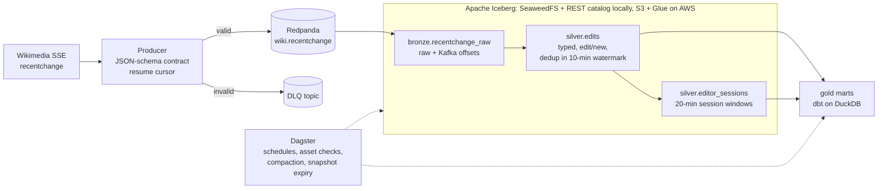

# realtime-lakehouse

**A streaming lakehouse over live Wikipedia edits. It is built like a production pipeline,
and it measures itself.**

Wikipedia publishes every change as it happens. This repo turns that firehose into Apache
Iceberg tables and gold marts with **exactly-once writes, a data contract with a dead-letter
queue, late-data handling, table maintenance and asset checks**. It proves each of those
claims with a script you can rerun. The same tables can be read from Spark, DuckDB and Athena.


| What was measured | Result | Evidence |
|---|---|---|
| Kill the stream with `SIGKILL` mid-backlog, then restart | **0 duplicates and 0 gaps**: 20,500 Kafka offsets once in bronze, 9,800 edits once in silver | [`scripts/prove_exactly_once.py`](scripts/prove_exactly_once.py), run in CI |
| Freshness: edit time to Iceberg commit, 100 to 9.6k events/s | **p95 20.2–21.0 s**, with a 10 s trigger | [`benchmarks/results.md`](benchmarks/results.md) |
| 2 h on AWS: EC2 + S3 + Glue, live stream | 868k events, **0 duplicates**, p95 20.0 s, all 42 Dagster runs green, **≈ $0.52** | [`benchmarks/aws-run.md`](benchmarks/aws-run.md) |
| Same Iceberg tables, three engines | Spark writes; DuckDB (dbt) and Athena read through the catalog | Same run |

---

## Architecture



Each hop has its own delivery guarantee:

| Hop | Guarantee | How |
|---|---|---|
| Wikimedia to Kafka | at-least-once | The resume position (`Last-Event-ID`) is saved only after Kafka has acknowledged every event before it. Events that break the contract go to the DLQ. |
| Kafka to bronze | exactly-once | Spark checkpoints plus idempotent Iceberg commits. Every Kafka offset lands once, even across `SIGKILL`. |
| Bronze to silver | once per event | Deduplicated on the Wikimedia event id within a 10-minute watermark. Events more than 10 minutes late are dropped and counted. |
| Silver to gold | rebuilt per run | dbt recomputes a 20-minute window each run, and a test reconciles the result against silver. |

Design notes and failure modes are in [docs/system-architecture.md](docs/system-architecture.md).

## Quickstart

You need Docker with 8 GB of memory: the stack uses about 4.8 GB at steady state, and
maintenance jobs need more. No API keys are required, and it runs on amd64 or arm64.

```bash
git clone https://github.com/tantn89/realtime-lakehouse && cd realtime-lakehouse
docker compose up -d --build                     # first build takes a few minutes
docker compose run --rm spark python -m wiki_lakehouse.lakehouse_status
```

Edits appear in silver within about 20 s, and the gold marts fill at the next 5-minute
schedule tick. Dagster runs at http://localhost:3000; every port is bound to `127.0.0.1`.

| Command | What it does |
|---|---|
| `python scripts/prove_exactly_once.py` | Isolated stack: publishes duplicates, poison messages and late events, kills the stream mid-backlog, then verifies every layer |
| `python scripts/run_benchmarks.py` | Replays a recorded sample at increasing rates, then measures freshness and the effect of compaction |
| `docker compose run --rm spark python -m wiki_lakehouse.smoke_check` | Writes and reads one Iceberg table through the catalog |

The AWS run, which is a Terraform apply, a measurement and then a destroy, is in
[docs/deployment-guide.md](docs/deployment-guide.md).

## Problems found along the way

Most of these only appeared under real load, on a fresh machine, or in review. Each is fixed
in the code and explained there.

1. **A polling reader saw a frozen table.** Iceberg's caching catalog expires an entry after
   it was last *accessed*. A verifier that polled every few seconds therefore kept the same
   snapshot forever and stalled at 5,479 rows. Readers of tables that other processes write
   now disable the cache.
2. **Streaming offsets broke on local checkpoints.** `S3FileIO` cannot write the Iceberg
   streaming source's offsets to a `file:` checkpoint. `ResolvingFileIO` picks the right
   FileIO for each path.
3. **SQLite as the catalog store failed under concurrent commits.** Three streams committing
   every few seconds hit `database is locked`, so the REST catalog now uses Postgres.
4. **Compaction made a query 4x slower.** Rewriting 21 files into one 15 MB file produced a
   single Parquet row group, which DuckDB scans on one thread (29 ms became 119 ms). With 8 MB
   row groups the query takes 56 ms. At this size, compaction's value is bounding file growth
   (about 3,400 files a day at a 10 s trigger), not speed.
5. **Freshness after compaction looked like 29 minutes.** Commit-time freshness maps each row
   to the snapshot that added its file, and compaction re-adds every file. The benchmark now
   measures before compacting, and the AWS report uses processing time.
6. **Half of "silver.edits" were not edits.** In the recorded sample, 204 of 400 events are
   `categorize` or `log`, which doubled gold counts. Silver now keeps `edit` and `new` only.
7. **Snapshot expiry could strand a stopped stream.** Expiring history older than an hour
   would delete the snapshot a stopped consumer's checkpoint points to. Retention is now 3
   days, and expiry is skipped while a downstream stream is stale.
8. **The producer could save its position past unacknowledged events.** The resume cursor is
   now committed only after a flush confirms delivery, and it is written atomically.
9. **Dagster failed on a fresh volume, first seen on AWS.** The webserver and the daemon ran
   the SQLite migrations at the same time and left two alembic heads. The daemon now waits
   for a healthy webserver.
10. **Late rows are dropped one micro-batch late.** Spark 3.5 checks lateness against the
    previous batch's watermark. The late-data tests are written around that.

## Gold marts

| Mart | Grain | Notes |
|---|---|---|
| `edits_per_minute` | minute × wiki | Incremental: a 20-minute recompute window covers the watermark and commit lag |
| `bot_activity_daily` | day × wiki | Bot vs human edit share |
| `trending_articles` | wiki × article | Top 50 in the last hour of data, ranked by distinct human editors, then by edits |
| `editor_sessions_daily` | day × wiki × bot flag | Sessions, edits per session, median session length |

There are 16 dbt models and tests. One reconciliation test checks the incremental mart
against silver. Dagster adds 4 asset checks: freshness, duplicates, volume and the DLQ share
over the last hour.

## Repository layout

```text
src/wiki_lakehouse/
  producer/        SSE client, contract and DLQ routing, Kafka publisher, resume cursor
  streaming/       Spark streams: bronze, silver, sessions, progress table
  orchestration/   Dagster definitions, asset checks, Iceberg maintenance
  reliability/     Scenario publisher and verifier for the exactly-once proof
  benchmarks/      Freshness and query-latency measurements
dbt/               Staging and marts on DuckDB, reading Iceberg
terraform/         Short-lived AWS run: S3, Glue, Athena, EC2 (SSM only), budget
scripts/           Proof and benchmark drivers (standard library only)
docs/              Architecture, deployment, design guidelines, roadmap
```

## Limits

- The Python producer tops out around 10k events/s on one process, so the benchmark did not
  saturate the pipeline.
- The CI proof kills the Spark stream but not the producer.
- Orchestration modules are checked against a live stack and in CI (`dagster definitions
  validate`), but they have no unit tests yet.
- `remove_orphan_files` is not scheduled: it needs the Hadoop S3A connector in the Spark image.

More in [docs/project-roadmap.md](docs/project-roadmap.md).

## License

MIT
