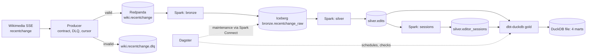

# System architecture

Why the pipeline is shaped this way, and where each part lives. Behavior details stay in the
source; this page links to it.

## Data flow

| Hop | Owner | Notes |
|---|---|---|
| Wikimedia to producer | `src/wiki_lakehouse/producer/sse_stream.py` | Reconnect with exponential backoff (max 60 s), `Last-Event-ID` resume, honours `Retry-After`. |
| Producer to Kafka | `producer/event_routing.py`, `kafka_publisher.py` | Idempotent producer, `acks=all`, zstd. Key = wiki, so one wiki's edits stay ordered in a partition. |
| Kafka to bronze | `streaming/streaming_queries.py` (`start_bronze`) | Raw record kept as a string plus Kafka coordinates; no parsing, so nothing is lost to a schema bug. |
| Bronze to silver | `streaming/edit_transforms.py` | Parse JSON, keep `edit` and `new`, dedup on event id, 10-minute watermark. |
| Silver to sessions | `edits_to_sessions` | Session window with a 20-minute gap, append mode. |
| Silver to gold | `dbt/`, run by Dagster | DuckDB reads Iceberg through the catalog; marts are a rebuildable DuckDB file. |

## Components by environment

| Concern | Local (`docker-compose.yml`) | AWS (`docker-compose.aws.yml`, `terraform/`) |
|---|---|---|
| Broker | Redpanda (3 partitions, 7-day retention) | Same container on one EC2 instance |
| Object store | SeaweedFS S3 (bucket `warehouse`) | S3 |
| Iceberg catalog | REST catalog (`tabulario/iceberg-rest`) backed by Postgres | Glue Data Catalog |
| Writers | Spark Structured Streaming (`stream` service) | Same image |
| Readers | Spark, DuckDB | Spark, DuckDB (Glue's Iceberg REST endpoint), Athena |
| Credentials | Fixed local-only placeholders | EC2 instance profile; no secret written anywhere |

The catalog choice is a single switch, `LAKEHOUSE_CATALOG_TYPE` (`rest` or `glue`), read in
`spark_session.py`, `orchestration/lakehouse_duckdb.py` and `dbt/macros/attach_lakehouse.sql`.
The last two must be kept in sync by hand (noted in both files).

Rejected: SQLite for the REST catalog. Three streams commit concurrently and SQLite fails them
with "database is locked", hence Postgres (comment in `docker-compose.yml`).

## Delivery semantics per hop

| Hop | Guarantee | Mechanism |
|---|---|---|
| Wikimedia to Kafka | At-least-once | The resume cursor is persisted only after a confirmed flush, so a crash replays events after the saved id (`producer/resume_cursor.py`). |
| Kafka to bronze | Exactly-once | Per-query checkpoint plus an atomic Iceberg commit that records the batch id; a replayed batch is not committed twice. |
| Bronze to silver | Exactly-once per event id within the watermark | `dropDuplicatesWithinWatermark(["event_id"])`; state is bounded to the window. |
| Late events | Dropped from silver | Events more than 10 minutes behind the newest event time are discarded by the dedup step, so they also never reach sessions or gold. Bronze keeps them; `ops.stream_progress.rows_dropped_by_watermark` counts them. |
| Sessions | Append once | A session is emitted when the watermark passes its last edit plus 20 minutes plus 10 minutes. A bot whose gaps never exceed 20 minutes never closes a session. |

Proof: [`scripts/prove_exactly_once.py`](../scripts/prove_exactly_once.py) loads 50 loops of a
400-event sample, resends 400 duplicates, adds 25 contract violations, SIGKILLs the stream
mid-backlog, restarts it, then sends 100 events stamped 30 minutes old. The verifier
(`src/wiki_lakehouse/reliability/verify_exactly_once.py`) checks that bronze holds every Kafka
offset once, silver holds every unique on-time edit once, no late event reached silver, and the
DLQ holds exactly the violations. CI runs it on every push.

## Table layouts

Declared in code, not inferred by the first write: `streaming/lakehouse_tables.py`.

| Table | Partitioning | Purpose |
|---|---|---|
| `bronze.recentchange_raw` | `days(kafka_ts)` | Raw value plus Kafka key, topic, partition, offset, timestamp, `ingested_at`. |
| `silver.edits` | `days(event_time)` | Typed edit and new events; `processed_at` is the micro-batch start. |
| `silver.editor_sessions` | `days(session_start)` | One row per closed session: edits, bytes changed, approximate page count. |
| `ops.stream_progress` | none | One row per micro-batch per query; the maintenance guard reads it. |

All four use Iceberg format version 2, zstd Parquet, 8 MB row groups (readers parallelise per row
group; with the 128 MB default a compacted file is one row group, which made DuckDB queries
slower), and metadata cleanup after commit.

Gold marts (`dbt/models/marts/`): `edits_per_minute` (incremental, delete+insert on minute and
wiki), `bot_activity_daily`, `trending_articles` (top 50 by distinct human editors in the latest
hour), `editor_sessions_daily`.

## Orchestration

`src/wiki_lakehouse/orchestration/definitions.py` is the entry point.

| Job | Schedule | Notes |
|---|---|---|
| `refresh_gold` | every 5 min | Skipped while the previous run is queued or running: the DuckDB file has one writer. |
| `lakehouse_checks` | every 5 min | Four asset checks in `lakehouse_checks.py`. |
| `iceberg_maintenance` | hourly at minute 7 | Compaction and snapshot expiry, submitted to Spark through Spark Connect. |

The streams are not Dagster jobs; their tables are external assets so lineage, checks and dbt
marts share one graph. The Spark Connect endpoint has no authentication and is reachable only on
the compose network.

## Failure modes and recovery

| Failure | Behavior | Recovery |
|---|---|---|
| Stream crash (SIGKILL) | Checkpoints plus idempotent commits keep tables correct | Restart; the proof script exercises this. |
| Producer crash | Resumes from the last confirmed event id; may resend a few events | Silver dedup absorbs them. If the state directory is missing, resume is disabled with a warning and a restart skips the gap. |
| Kafka rejects or never confirms a delivery | `DeliveryError`, exit 1, cursor stays put | Compose restarts the producer from the saved position. |
| Poison event | Routed to the DLQ with the reason, stream continues | Inspect the DLQ; the `contract_violations_are_rare` check fails above 1% of the last hour. |
| Stream stopped for a while | Kafka keeps 7 days; the Iceberg source reads from its checkpointed snapshot | Restart; catch-up batches are bounded by `streaming-max-files-per-micro-batch`. |
| Snapshot expired under a consumer | Consumer could not resume | Prevented: expiry (3-day retention) is skipped for a source table whose consumer has not committed for 15 minutes. |
| Consumer down longer than 3 days | The guard sees liveness, not position, so it can look healthy after a long outage | Supported consumer downtime is under 3 days (documented in `iceberg_maintenance.py`). |
| Compaction | Writes `replace` snapshots, which the Iceberg streaming source skips | Intended. Streaming-source options are in `streaming_queries.py`. |
| Late event behind the watermark | Dropped from silver, kept in bronze | Counted in `ops.stream_progress`; replay from bronze is manual. |
| Orphan files from failed commits | Remain in storage | Not handled yet; see [project-roadmap.md](project-roadmap.md). |
| Dagster first boot on a fresh volume | Two processes migrating SQLite left two alembic heads (seen on AWS) | The daemon now waits for a healthy webserver (`docker-compose.yml`). |

One metric caveat: commit-time freshness maps each row to the snapshot that added its file, so
after compaction it reports minutes instead of seconds. Measure before compacting, or use
`processed_at` ([aws-run.md](../benchmarks/aws-run.md)).
